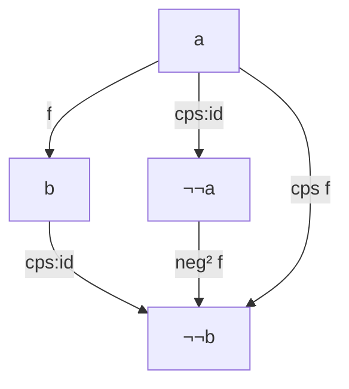

# Astra：落回 𝒟 与否定翻译的独立评审（2026-10-16）

回答 10/16 的两段式提示词（第一步只读指定材料独立作答，第二步再对照讨论记录）。Astra 能看到两个仓库及 GitHub 上的 issue、PR。Noah 10/16 转来，原文照录。

---

**我的整体判断是：这两节值得保留，但主问题应从“箭头怎样落回一个世界”，改为“已经编码好的计算，怎样继续接上下一步”。** 后者能同时解释 `neg²`、那道“𝒦 经 𝒰 到 𝒟”的练习，以及 `anf:let*`。现在三者的联系其实已经在代码里，却没有成为叙事主线。

读完第二步材料后，我仍保持这个判断。最大的分歧是：**我不建议把“按名与按值两种嵌入”作为这次重写的主要落点。** 试验揭示了真实区别，但这个区别不能由 `¬¬a → ¬¬b` 和 `a → ¬¬b` 两种类型直接判定。

我按要求先完成了独立判断，再打开讨论材料。正文底本是 `dev` 的 `b7a6ec7`；数学仓库读到 `f8cfac3`。下面的数学等式标为〔推导〕，文献结果另标〔定理〕；没有用凭记忆的结论承重。运行核对使用 **Racket 8.10，`#lang typed/racket/no-check`**，不代表通过了静态类型检查。

**第一步：独立判断**

**1. 读者此时有什么问题？**

读到 `∘𝒦` 和编码中的 `call/cc`，读者已经获得两项能力：

- 能把 CPS 步骤接起来，不必每次手写延续。
- 当前延续已经是参数，可以实现捕获和逃逸。

此时最自然的问题是：

> 既然已经有这些接法，为什么还要用宿主的 `call/cc` 把结果拆出来？能不能一直操作编码好的计算，把整个程序写完？

它包含两个层次，应分别回答：

| 读者的问题 | 应承担回答的内容 |
|---|---|
| 不调用宿主 `call/cc`，怎样实现逃逸？ | `cps:call/cc` 的构造 |
| 不拆出裸结果，怎样继续运算、绑定名字？ | `neg²`、一般的接续操作、`anf:let*` |

当前“落回 𝒟”先问的是：节点换成 `¬p` 后，箭头方向怎么不对了？这是作者在检查结构时会问的问题，但读者未必已经需要这项检查。于是第二次 `neg` 看起来是在修补图表，实际用途反而留到练习和后面的宏里。

我会让箭头方向成为**解释已经造出的接法**的一部分，而不让它产生主要动机。

**2. 不用“函子”，怎样介绍 `neg²` 及其与 `cps`、`anf:let*` 的关系？**

先给读者一段已经编码的计算 `m : ¬¬a`，再给一个普通纯函数 `f : a → b`。问题很具体：

> `f` 要一个 `a`，手里却只有等待延续的 `m`。怎样把 `f` 接进去，同时继续保留编码？

展开现有定义：

\[
\operatorname{neg}^{2}(f)(m)
=\lambda k_b.\;m(\lambda a.\;k_b(f(a))).
\tag{推导}
\]

这句话足够说明用途：

> 等 `m` 交出一个值，让它经过 `f`，再交给最终的延续。

随后再认出：交给 `m` 的延续正是 `(neg f)` 作用于 `kb`；整个构造因此是两次 `neg`。

接着只改变一个条件：后一步自身也交出编码，即 `h : a → ¬¬b`。此时需要：

\[
\operatorname{extend}(h)(m)
=\lambda k_b.\;m(\lambda a.\;h(a)(k_b)).
\tag{推导}
\]

按你的现有定义：

\[
\boxed{\operatorname{extend}(h)=\operatorname{neg}(\operatorname{flip}(h))}
\]

并且：

\[
\boxed{
\operatorname{neg}^{2}(f)=\operatorname{extend}(\operatorname{cps}(f))
}
\qquad
\boxed{
\operatorname{extend}(h)=(\circ_{\mathcal K}\;h\;\mathrm{id})
}.
\tag{推导}
\]

**这就是我认为应该从练习升到正文的联系。**

`anf:let*` 的单个绑定，恰好把后面的 body 包成 `h`，再将 `extend h` 用到前一步计算上。于是：

- `cps f`：普通值进来，编码的结果出去。
- `neg² f`：已有计算的结果经过普通函数 `f`。
- `extend h`：已有计算接上一个继续产生计算的步骤。
- `anf:let*`：替程序员写出接收中间结果的那个 λ。

以上都是〔推导〕。`extend` 只是我在这份评审里使用的临时名字，正文未必需要增加一个公共运算符。

下面这段可以放在正文仓库根目录运行；其中各项已实际核对：

```racket
#lang typed/racket/no-check
(require rackunit racket/port "zh/02-cps/code.rkt")

(: extend
   (∀ (a b) (→ (→𝒦 a b) (→ (¬¬ a) (¬¬ b)))))
(define extend (∘ neg flip))

(define m (cps:id 3))

(check-equal? (anf:eval ((neg² add1) m)) 4)
(check-equal? (anf:eval ((extend (cps add1)) m)) 4)

(check-equal?
 (anf:eval ((extend (cps add1)) m))
 (anf:eval
  (anf:let* ([x m])
    ((cps add1) x))))

;; neg² 不会自动连接一个本身返回计算的函数。
;; 这里得到的是两层编码，运行外层后仍是函数。
(check-true
 (procedure?
  (anf:eval ((neg² (cps add1)) m))))
```

**3. `¬¬a → ¬¬b` 能做什么，不能做什么？能否取代 Kleisli 箭头？**

这里要分清**类型形状**与**产生这种箭头的特定办法**。

| 对象 | 入口 | 职责 |
|---|---|---|
| `h : a → ¬¬b` | 一个普通值 | 描述拿到中间结果后的工作 |
| `extend h : ¬¬a → ¬¬b` | 一段编码计算 | 把那段工作接到计算之后 |
| `neg² f : ¬¬a → ¬¬b` | 一段编码计算 | 特别地，接上普通纯函数 `f` |

〔推导〕不能因为第三行受到限制，就把限制归给第二行的全部类型。

对于由 `extend` 得到的表示，我们有：

\[
(\operatorname{extend}(h))(\operatorname{cps:id}(a))=h(a),
\]

\[
\operatorname{extend}(j\circ_{\mathcal K}h)
=\operatorname{extend}(j)\circ\operatorname{extend}(h),
\]

\[
\operatorname{extend}(\operatorname{cps:id})=\mathrm{id}.
\tag{推导}
\]

第一条展开后就是：

\[
\lambda k.\;(\operatorname{cps:id}(a))
  (\lambda x.\;h(x)(k))
=\lambda k.\;h(a)(k).
\]

在正文约定的纯、分阶段 CPS 片段里，它就是 `h(a)`。

所以，**如果“取代”指能否换一种表示，保留这些步骤及其组合，那么可以。** 它并非表达能力天然不足。

但如果“取代”指程序员能否照常用宿主 `let*` 给**普通中间结果**起名字，那么仅仅改用这些箭头并没有解决问题：

- 宿主 `let*` 绑定的仍是 `¬¬a`。
- 要获得 body 中那个 `a` 的名字，仍要把 body 写成接收 `a` 的 λ。
- 把这些 λ 自动生成出来，就又得到绑定语法。

〔推导〕因此，二者的分工首先是**写步骤的接口**与**接整段计算的接口**。保留 Kleisli 箭头的理由很实际：它正好让程序员写“拿到 `v` 后怎么办”。

它们都不会自动消除闭包内部已有的宿主效应，也不会凭空提供一般的纯 `¬¬a → a`。后者正是直觉主义逻辑不普遍验证的双重否定消去。〔定理：可核对 Leroy 第四讲，幻灯片 6、11。〕[xavierleroy.org](https://xavierleroy.org/CdF/2018-2019/4.pdf?utm_source=chatgpt.com)

**4. “否定翻译”应落在哪里？**

我会把三个层次明确分开：

| 层次 | 做了什么 | 能作出的承诺 |
|---|---|---|
| `neg² f` | 包装已有函数 | 给纯函数一个作用于编码计算的接口 |
| `cps:call/cc` | 用显式延续重新实现控制操作 | 这一控制构造不需要调用宿主 `call/cc` |
| 整段程序的改写及宏展开 | 改写原语接口、应用、绑定和控制步骤 | 指定源语言片段的控制可由目标函数程序表示 |

〔推导〕对现有运行时代码，`neg²` 应写成：

\[
(a\to_{\mathcal D}b)
\longrightarrow
(\neg\neg a\to_{\mathcal D}\neg\neg b).
\]

“虽然签名写 `𝒞 → 𝒟`，但实际上只翻译类型”不能修复它，因为 `→𝒟` 已经对产物作了纯性的承诺。

还应同步检查 `neg` 的两种读法和图表旁的文字。**构造器自身只写了 lambda，不代表它返回的闭包不会调用带效应的参数。** 不能只改 `neg²` 那一行，却继续让上游路径无条件保证“进入纯宿主”。〔推导〕

另外，现有 `anf:` 宏接受的是已经按其接口编写的嵌入程序。它不会进入一个任意 Racket 函数，检查并改写其中的宿主 `call/cc`。因此准确的叙事应是：

> 我们把程序逐步改写成这套嵌入语法；宏再把它展开成显式延续代码。

对高阶程序，还必须相应处理内部的函数类型。例如按值 CPS 中，源函数值的类型要变为“接收翻译后的参数值，交出结果计算”，不能只在整个旧类型外加两层否定。〔定理／标准翻译规则：Selinger 2001，§7.1，Definition 7.1、Table 7 及式 (2)。这支持翻译层次的区分，不是对本文宏的完整正确性证明。〕[mscs.dal.ca](https://www.mscs.dal.ca/~selinger/papers/control.pdf?utm_source=chatgpt.com)

因此我会把“否定翻译”的**任务说明放在宏之前，正式命名和回收放在完整程序之后**。

**5. “同构，所以也有 `call/cc`”怎么改？**

我建议直接撤掉这条承重推理，保留后面的实际构造。

读者此时已经知道：`call/cc` 把当前延续交给 `proc`。那么在 CPS 里：

1. 当前延续 `kp` 已经是参数。
2. 给 `proc` 一个符合 CPS 接口的逃逸函数。
3. 正常路径仍沿着 `kp` 继续。

这就导向现有定义：

```racket
(define ((cps:call/cc cps:proc) kp)
  ((cps:proc (cps kp)) kp))
```

〔推导〕在本篇 `kp` 不返回的约定下，调用 `(cps kp)` 会调用保存的 `kp`，因而不会继续调用处的后续工作。这里“不返回”的条件有实际作用，不能仅凭外形推广到任意会返回的延续。

构造完，再检查它的类型读作编码中的 Clavius 形状。这符合“先造后认”。

原推理的缺口则是：**只证明箭头、恒等、复合相对应，还没证明嵌套函数类型也按所写的方式对应。** `call/cc` 的参数本身是高阶函数；把一个高阶箭头搬过去，不等于已经证明其类型中每个 `→𝒞` 都可以逐字换成 `→𝒦`。〔推导〕

所以同构讨论可以作为回顾，但不必用它保证尚未构造的控制能力。

**6. 顺序和交换图表怎样排？**

我的首选顺序是：

1. 造出 `∘𝒦`，认出空步骤及连接规律。
2. 从显式延续造出 `cps:call/cc`。
3. 问已有编码计算怎样继续工作，先接普通函数，认出 `neg²`。
4. 后一步也返回编码时，造出练习里的接法。
5. 认出同一接法就是 `anf:let*` 的绑定。
6. 写出完整嵌入程序，回收“否定翻译”。
7. 最后整理世界之间的关系及运行边界。

首次图表，我更愿意画**具体类型之间的交换关系**：



这张图表达：

\[
\operatorname{neg}^{2}(f)\circ\operatorname{cps:id}
=\operatorname{cps}(f)
=\operatorname{cps:id}\circ f.
\tag{推导}
\]

每条路径都能交给同一个参数核对，节点变化也可见。随后用 `extend` 的复合等式说明：“先在 𝒦 里连接，再变成计算之间的箭头”，等于“先变换，再用普通复合连接”。

四世界总图可以保留在后面，但要明确哪些边改变类型、哪些只是受条件限制的运行时往返。它应总结已经解释清楚的关系。

---

**第二步：对照后的判断**

我读了六份 `series/reviews/` 记录、两份指定试写及三个相关检查脚本，以及数学仓库 #15、#21、#33、正文 #77 和 PR #78。

**一致之处，比不同之处多。**

| 问题 | 对照结果 |
|---|---|
| `neg²` 改为纯输入、纯输出 | 与已定结论完全一致 |
| 包装函数与整段翻译分开 | 与 Astra、Claude 的收紧版一致 |
| `call/cc` 从显式延续构造 | 一致 |
| 宏中的 `id` 不消除双重否定 | 一致 |
| 消去普通 `id` 与消去 `cps:id` 依据不同 | 一致 |
| 单位律、结合律进入第二篇 | 一致 |
| “落回”与绑定的关系 | 我的 `extend` 正是试验中的“落回” |
| 调整顺序 | 更接近 Astra 第一轮的拆分方案，不倾向仅保留原顺序、补限定 |

这也意味着：我不能把“落回就是扩张、与 `neg²` 有关系”算作你们漏掉的发现。记录和试验已经明确写出来了。我的建议是**提高它在正文中的地位**。

**对《再次隐藏延续－试写－2026-10-15》的看法**

这份改写有实质进步，尤其是：

- 先写出绑定应该执行的 `m(λv. B(v)(k))`，再认出已有 `∘𝒦` 可以表达它。
- 第一次出现普通 `id` 时就展开类型，说明它没有取出普通值。
- 区分连接等式与单位律，使化简不再每一步都临时解释规则。

这些值得保留。PR #78 又把部分运算律分散到它们实际出现的位置，比试写中集中放在“甲”更适合连续阅读。

我的保留是：**六步压成三步，仍不一定让核心更容易看见。** 第一行嵌套了两个 `∘𝒦`、两个 λ 和两个 `id`，读者仍可能主要在追括号。

如果前面已经认出“落回”，这里可以先用一条短关系把两节接上：

\[
\operatorname{neg}(\operatorname{flip}(h))
=(\circ_{\mathcal K}\;h\;\mathrm{id}).
\tag{推导}
\]

然后说明：宏做的就是把 body 包成 `h`，应用这条接法。这样，普通 `id` 成为**已经理解的接续操作的一种实现**，不再像为解决眼前类型问题突然插入的零件。

我不会要求正文新增一整套 `extend` 命名；认出一次这条等式即可。

**对《落回D重写嵌入语言－2026-10-16》的看法**

我认为**第一轮试验更接近本篇当前需要的材料**。

其中最有价值的事故是：把返回计算的 `g` 直接交给 `neg²`，多出一层编码，最后把函数交给乘法。这能准确引出：

> 后一步交出普通结果时，两次 `neg` 够用；后一步交出的还是计算，就需要另一种接法。

这比“方向翻回来才正确”更容易产生读者动机。〔推导，并已复现该报错〕

但有两句话需要改。

第一句是：

> 一旦后一步要做的事取决于前一步的结果……就多出一层 `¬¬`。

**“依赖前一步结果”不是分界。** 普通 `f(a)` 本来就在依赖 `a`，纯函数内部也完全可以分支。真正的区别是，后一步交出的是 `b`，还是 `¬¬b`。〔推导〕

第二句是：

> 只用 `neg²` 写不出阴阳谜题。

试验展示了指定接法怎样失败，但还没有给出一个精确受限语言中的不可表达性证明。正文最好说“这种逐步替换没有接上所需的后续工作”，而不要把一次失败升级成所有写法都不可能。〔推导：对证据强度的判断〕

**第二轮按名试验，现象成立，但概括应收窄。**

最重要的一点是：

\[
\boxed{
\neg\neg a\to\neg\neg b
\quad\text{并不自行决定按名求值。}
}
\]

第一步已经得到的 `extend h` 就是反证思路：它具有这个类型，却完整保留所接 CPS 步骤的组合。〔推导〕

还可以直接构造两个同型的接法。以下接在前面的测试代码之后即可，已实际运行：

```racket
(: shared (→ (¬¬ Integer) (¬¬ Integer)))
(define shared
  (extend (λ (v) (cps:+ v v))))

(: repeated (→ (¬¬ Integer) (¬¬ Integer)))
(define ((repeated m) k)
  (m (λ (a)
       (m (λ (b)
            (k (+ a b)))))))

;; 输出只作为观察调用次数的探针。
(define (probe k)
  (display "!")
  (k 1))

(define (observe transform)
  (with-output-to-string
    (λ ()
      (check-equal?
       (anf:eval (transform probe))
       2))))

(check-equal? (observe shared) "!")
(check-equal? (observe repeated) "!!")
```

两者结果都是 `2`，前者运行输入计算一次，后者两次。**决定区别的是接法怎样使用计算，而不是这两端的类型。**〔推导＋实测〕

所以，我会把试验结论改为：

> 在这套改写中，名字绑定的是可重新运行的计算；每次需要它的结果时，会重新运行。加入按值绑定以后，名字使用的是先前得到的结果。

标准按名 CPS 确实与 Kolmogorov 否定翻译相联系，按值 CPS 则与 Kuroda 的一种变体相联系；但这里说的是**递归定义的类型翻译与项翻译**。Leroy 第四讲幻灯片 35–40 明确给出了两套规则，不能仅用一个 `¬¬a → ¬¬b` 的局部外形替代它们。〔定理及翻译规则：已核对该讲义；未独立复核 Murthy 博论的证明。〕[xavierleroy.org](https://xavierleroy.org/CdF/2018-2019/4.pdf?utm_source=chatgpt.com)

`neg²:call/cc` 的类型观察本身有依据。令 \(T a=\neg\neg a\)、\(X=T(Ta\to T⊥)\)，它的类型是：

\[
T(X\to Ta)\to Ta.
\]

按 Kolmogorov 规则展开相应 Clavius 公式，会在整个类型外再有一层 \(T\)。这里的结果是负类型，可以构造性地消去那层外包装，因此“外面少一层”的观察可以解释。〔推导〕

但这项类型事实不等于已经证明整套试验语法是一个完整、保语义的按名翻译，也不使第三个 `call/cc` 成为第二篇的必需内容。

**我认为还应特别补出的两点**

一是**构造计算与运行计算的时机**。试验中递归必须额外加 λ，正说明 `neg²:if` 虽然接收延迟计算，Racket 仍会先求值它的各个参数表达式。如果参数表达式在“造计算”时就递归、打印或跳转，分支尚未选定，那些行为已经发生了。所谓按名解释必须连同这项构造约定说明。〔推导〕

二是**按值绑定并不意味着整个计算对象此生只运行一次**。你的 `neg²:let1` 是在每次执行该绑定、每次后续恢复的相应动态路径上取得结果，再把结果包回去；它不是给计算对象加了全局缓存。这里可以与“绑定计算”“绑定结果”区分清楚，不必再展开按需求值。〔推导〕

我的取舍是：**采用 10/15 稿的绑定入口，用 10/16 稿中“多一层编码”的事故连接 `neg²` 与落回，再用一个很短的重复运行对照说明为什么要绑定结果。** 完整按名语言和第三种 `call/cc` 暂不进入主线。这样既保留试验最有解释力的发现，也不会为解决旧难点再开启一整组新问题。

运行方面：第一步新增的 10 项检查、第二篇原有测试子模块、两份试写对应的三个检查脚本均已在 Racket 8.10 上执行，无检查失败；“按名版本只观察到 `@*`”仍只是脚本观察窗口内的结果，不据此宣称证明了其之后永不输出。