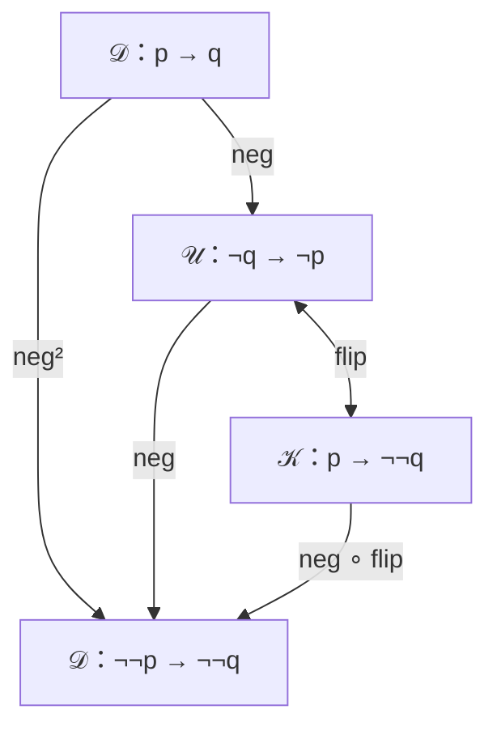

# Sol：逆否的构造性替身（2026-10-17）

回答《咨询说明-逆否的构造性替身.md》，两步作答。Sol 能看到两个仓库及 GitHub 上的 issue、PR（这一轮用 Sol 代替 Astra）。Noah 10/17 转来，原文照录。

---

**我赞成采用这个新动机。** 它接住了“回到原来的类型需要经典操作”这个已有障碍，第二次 `neg` 因而有了理由。但它最好只负责引出构造性的出口；这个出口为什么值得继续研究，要由“怎样接上已经编码的计算”和宏来兑现。

我先写定了第一步七问，再读第二步材料。下面保留这个区分。没有向两个仓库写入或推送任何东西。

运行核对使用 **Racket 8.10 [cs]、`#lang typed/racket/no-check`**：第二篇原有测试与新增检查合计 **24 项通过**。新增检查覆盖落回与宏的对应、复合与单位，以及后面提到的答案类型反例。逻辑证明项也已装载，但这些运行结果不代表静态类型检查或逻辑健全性证明；其他评审附带的脚本没有全部重跑。

**第一步：七个问题的独立判断**

**1．数学上成立吗？**

成立，但应分开四件事。

**逆否律再次实例化，确实得到第二种读法。〔推导〕**

已有：

\[
(A\to B)\to(\neg B\to\neg A).
\]

代入 \(A=\neg q,\ B=\neg p\)，就是：

\[
(\neg q\to\neg p)\to(\neg\neg p\to\neg\neg q).
\]

给定 \(u:\neg q\to\neg p\)，其结果作用于 \(m:\neg\neg p\) 和 \(n_q:\neg q\) 时：

\[
(\operatorname{neg}u)(m)(n_q)=m(u(n_q)).
\]

这里没有消除双重否定，也没有调用经典规则。它就是已有的 `neg`，不是另造的一种翻译。

**逆否律的逆方向，作为对任意 \(p,q\) 成立的模式，与 DNE 等强。〔推导〕**

给定 DNE，可以先由 \(u\) 和 \(p\) 构造 \(\neg\neg q\)，再消除它。

反过来，把逆方向中的 \(p\) 取为 \(⊤\)，便能由 \(\neg\neg q\) 得到 \(q\)。因此它不是一般的直觉主义定理。不过，对某些具体类型可以构造性地回来，例如已经有 \(\neg\neg q\to q\) 的稳定类型。正文用“一般不能”更准确。

**\(\neg\neg(p\to q)\leftrightarrow(\neg\neg p\to\neg\neg q)\) 也成立。〔推导〕**

两个方向可以直接证明。

给定 \(h:\neg\neg(p\to q)\)，构造：

\[
\lambda m.\lambda n_q.\;
h\bigl(\lambda f.\;m(\lambda p.\;n_q(f(p)))\bigr).
\]

反方向，给定 \(g:\neg\neg p\to\neg\neg q\)，假设：

\[
n:\neg(p\to q).
\]

由这个假设构造：

\[
m=\lambda n_p.\;
n(\lambda p.\;\operatorname{absurd}(n_p(p)))
:\neg\neg p,
\]

\[
n_q=\lambda q.\;n(\lambda p.\;q):\neg q.
\]

于是 \(g(m)(n_q):⊥\)，得到 \(\neg\neg(p\to q)\)。

反方向用了爆炸原理 `absurd`，所以这里说的是直觉主义逻辑，不能直接把 \(⊥\) 换成任意答案类型。

这是**逻辑上的互相可推**，没有证明这两个转换在程序上互为逆。

出处方面，第一步我只把 Glivenko 标为凭记忆。第二步以后核对到了：

- **〔定理，已核原文〕** Glivenko，1929，*Sur quelques points de la Logique de M. Brouwer*，第 183 页命题 \(1^\circ\)：经典命题逻辑可证的公式，其双重否定在直觉主义命题逻辑中可证。原文证明至第 188 页。[upload.wikimedia.org](https://upload.wikimedia.org/wikipedia/commons/2/2a/Sur_quelques_points_de_la_logique_de_M_Brouwer.pdf?utm_campaign=index\&utm_content=original\&utm_source=chatgpt.com)
- **〔定理，已核文献〕** Ferreira–Oliva，*On Various Negative Translations*，§1.1、论文第 3 页、Lemma 1 的证明，直接列出了上面所问的蕴含等价式。[webpages.ciencias.ulisboa.pt](https://webpages.ciencias.ulisboa.pt/~gmferreira/NegTrans.pdf?utm_source=chatgpt.com)

因此说明中的数学判断是对的。但 **Glivenko 说明的是可证性及证明翻译，不能证明运行时的 `neg²` 会消除传入函数内部的 `call/cc`。**

**2．读者动机更好吗？有没有更自然的问法？**

比“方向对调”好。

现稿刚告诉读者：要回到 \(p\to q\)，必须消除双重否定。接下来问“不消除它，还能得到什么”，确实是在追问眼前的障碍。

不过，我会改掉说明里的“**只能**推出 \(\neg\neg p\to\neg\neg q\)”。因为读者手里已经有 `flip`：

\[
\neg q\to\neg p
\quad\longmapsto\quad
p\to\neg\neg q.
\]

所以新出口并不是唯一的构造性结论。只问“还能推出什么”，也不足以解释为什么偏偏选择两端都带双重否定。

我更倾向于把问题收紧为：

> 不把编码拆掉，能不能让这一步接收一个已经编码的输入？

此时 \(p\to\neg\neg q\) 和 \(\neg\neg p\to\neg\neg q\) 的区别就有了程序意义：前者等一个值，后者能够接上已有的计算。

“逆否律的逆的构造性替身”适合作为这一观察的解释；它不必承担全部编程动机。

**3．几节怎么排？落回在宏之前还是之后？**

第一步我的倾向是：**构造性出口提前，完整用途留到绑定处展开。**

具体安排是：

1. “经典与构造”中引入纯宿主 𝒟，给出经典出口与构造性出口的类型对照。
2. 从显式延续直接构造 `cps:call/cc`。
3. 简短说明编码与运行的区别。
4. “再次隐藏延续”遇到现成的 \(\neg\neg a\) 时，展开构造性出口怎样接上下一步。
5. “嵌入语言”后，回收完整程序的否定翻译。

这里最应该进入正文的是：

\[
\begin{aligned}
\operatorname{extend}(f)
&=(\operatorname{neg}\circ\operatorname{flip})(f),\\
\operatorname{extend}(f)(m)(k)
&=m(\lambda x.\;f(x)(k)),\\
\operatorname{extend}(f)
&=(\circ_{\mathcal K}\;f\;\mathrm{id}).
\end{aligned}
\tag{推导}
\]

`extend` 只是本答复的临时名字，不一定需要增加正文 API。

这样，前面出现的是“有这个出口”，宏处回答的是“这个出口正好完成一次绑定”。不必提前把同一件事完整讲两遍。

`←`、`⨾` 可以在解释 `reverse` 时就地认出，或者保留为简短回顾；它们不再负责产生第二次 `neg` 的动机。

**4．图怎样才交换？𝒞 和 `inj` 怎么处理？**

主图应先限定：𝒰、𝒦 中的箭头，其宿主实现属于 𝒟。然后把输入输出的变化画出来：

底下的 𝒟 仍是同一个纯宿主，只是这次比较的箭头两端变成了双重否定。

交换性对应的是这些具体等式：

\[
\operatorname{cps}=\operatorname{flip}\circ\operatorname{neg},
\qquad
\operatorname{extend}=\operatorname{neg}\circ\operatorname{flip},
\qquad
\operatorname{neg}^{2}=\operatorname{extend}\circ\operatorname{cps}.
\tag{推导}
\]

**𝒞 可以保留在讲运行与经典出口的图里，不宜再与这张图合成一个“所有路径都相同”的环。**

原因不仅是算出来不同，还是两条路径落入了不同的箭头集：

\[
\operatorname{unneg}(u):p\to_{\mathcal C}q,
\]

而

\[
\operatorname{inj}(\operatorname{neg}(u)):
\neg\neg p\to_{\mathcal C}\neg\neg q.
\]

`inj` 只说明纯箭头可以在含控制的宿主中使用。它不消除双重否定，也不会让绕回 𝒟 的 `neg²` 变成恒等。

如果正文主要想让读者理解一次计算，先画具体类型的自然性方块也很好：

\[
\operatorname{neg}^{2}(f)\circ\eta_p
=\operatorname{cps}(f)
=\eta_q\circ f.
\tag{推导}
\]

**5．纯性前提怎么说？与“𝒦、𝒰 是经典的”矛盾吗？**

不矛盾，但表格现在把两种层面挤进了“逻辑”一栏。

需要区分：

| 层面 | 在说什么 |
|---|---|
| 宿主实现属于 𝒟 | 构造和连接这些表示，不依赖宿主控制操作 |
| 编码内提供经典控制 | 程序可以通过显式延续实现本文的经典控制接口 |

因此，𝒦、𝒰 那一栏可以写成“编码中的经典控制”，并在附近说明它们的表示可由构造性宿主实现。

纯性限定建议只说一次：

> 以下交给这些接法的箭头，本身也只用 𝒟 中的操作构造；包装不会改写它内部的程序。

“只用 lambda 写成”还不够：lambda 可以调用自由变量中藏着的 `call/cc`，也可以递归发散。需要属于 𝒟 的是相关实现及其依赖，不只是最外层语法。

同时，**只改 `neg²` 的签名还不够**。`neg` 的第二种读法也必须受同一范围限定，否则图上仍有一条无条件把含效应实现送入 𝒟 的边。

**6．是否给自伴随留好了伏笔？**

留得很好。它让三件事同时变得可见：

- `neg` 翻转箭头；
- `flip` 在两种参数安排之间转换；
- `cps id` 把值送入双重否定。

但需要防止三个误读。

首先，通常按分量记法，单位是：

\[
\eta_p=(\operatorname{cps}\;\mathrm{id}_p),
\]

而对一般纯箭头 \(f:p\to q\)：

\[
\operatorname{cps}(f)=\eta_q\circ f.
\tag{推导}
\]

其次，自伴随的“反变”不能丢掉。幕后准确的类型是：

\[
N:\mathcal D\to\mathcal D^{op},
\qquad
N^{op}:\mathcal D^{op}\to\mathcal D,
\qquad Np=\neg p.
\]

相应的 Hom 集双射来自：

\[
\mathcal D(p,\neg k)
\cong\mathcal D(p\times k,R)
\cong\mathcal D(k,\neg p).
\tag{推导：指数的泛性质与交换参数}
\]

最后，**`flip` 的参数交换同构，与逻辑公式之间的 \(\leftrightarrow\)，不是同一种保证**。不能因为上面的双重否定公式逻辑等价，就把程序转换也画成互逆。

这些精度留在账本即可，第一部不必点名伴随。

**7．还有什么没有想到？**

第一步我最在意的是三点：

- **新动机解决了第二次 `neg` 为什么出现，尚未单独解释为什么选双重否定作为两端。** 接受已有计算、保持连接，才把这个选择落实。
- **单个箭头的处理不能独自承担整个语言的否定翻译。** 高阶类型里的函数部分，以及程序中的应用、绑定、控制，都需要相应处理；不是给任意旧函数外面套一次包装。
- **Glivenko 不必进入正文的承重主线。** 这条局部构造已经有短小的直接证明。定理可以作为出处或回顾，避免为解决旧难点又引入一个新定理。

---

**第二步：对照之后，哪些改变，哪些不变？**

读完三份评审、背景第 1 组和 [issue #33 最后一条评论](https://github.com/NoahStoryM/algebraic-control-flow-math/issues/33#issuecomment-6217477347) 后，我的变化主要是安排上的，核心数学判断没有改变。

| 问题 | 对照后的判断 |
|---|---|
| 新动机是否成立 | 不变，支持采用；仍须删掉“只能推出” |
| 落回与绑定是同一接法 | 不变；三份评审已经明确，不算这次的新发现 |
| `neg²` 不能消除输入内部的控制操作 | 不变；签名与上游限定必须一起改 |
| 四世界图能否直接称交换图 | 不变；必须显式处理对象变化 |
| 落回应在宏前还是宏后 | 调整为“两次、不同深度的出现” |
| `cps` 是否可以称单位 | 读到 1.2 的对角线约定后，我接受这个称呼；通常分量记法的说明不应当作对账本的纠错 |

篇章顺序上，我现在更明确地建议：

**提前给出构造性出口，绑定处完整构造，程序写成后再总结否定翻译。**

这保留了 Astra 所强调的前后用途联系，也接受 Opus 和 #33 的“先造绑定，再认出落回”。原先争论的是整个“落回 𝒟”章节放哪里；新动机允许把它拆成两个不同职责的段落，因而不再必须二选一。

背景 1.10 的确进一步说明了为什么这条路线值得保留：`neg`、`flip` 的两两复合不是零散技巧，而是在展示同一组结构的数据。我仍建议第二篇首先用程序用途组织它们，最后才并排认出这些复合关系。

**对照后，我认为还需要补查四处。**

**一是，“构造性替身”并不等于已经取得另一条伴随。〔推导〕**

1.10 已经区分了纯否定伴随，与含控制宿主中的 `inj ⊣ R`，也写明后者作用于程序需要语法翻译。这一点很重要。

因此，第二次 `neg` 可以直接由当前代码证明；实际含控制语言的右伴随，则还需要明确源语言、翻译及比较程序的等式。不能用前者的几行组合等式，顺带证明后者对完整 Racket 宿主成立。

**二是，“原样运行输入一次”不能代替自由代数同态的条件。〔推导＋实测〕**

#33 对几份评审的总结说，其余变换会丢弃、重复输入计算。这些是好例子，但不是穷尽。

在账本 1.1 允许的一般答案类型下，取 \(R=\text{Boolean}\)：

\[
T A=(A\to R)\to R.
\]

考虑：

\[
H(m)(k)=\operatorname{not}(m(k)).
\]

它只调用输入计算一次，却仍不可能是某个 Kleisli 箭头的扩张。

取 \(m_0(k)=\#f\)，对任何 \(f\) 都有：

\[
\operatorname{extend}(f)(m_0)(k)=\#f,
\]

而：

\[
H(m_0)(k)=\#t.
\]

这个反例已在要求的 Racket 环境下运行。它使用的是一般答案类型，不能冒充绝对空类型 \(⊥\) 下的闭合运行例子。

所以账本中最准确的判据仍是同态条件：

\[
H\circ\mu_A=\mu_B\circ T(H).
\]

“运行一次”可以解释标准扩张怎样工作，不能充当完整分类。

**三是，Glivenko 的逻辑解释与一般答案类型的自伴随，需要分别成立。〔推导〕**

第二次 `neg` 的定义只用了复合，因此对一般 \(R\) 也成立。这很好，它正能连接后面的相对否定。

但第 1 问中证明

\[
\neg\neg(p\to q)\to\!\!\leftarrow
(\neg\neg p\to\neg\neg q)
\]

的反方向用到了 \(⊥\to q\)。不能未经处理就把它搬到任意 \(R\)。

因此，Glivenko 是这一步的一个逻辑读法；更一般、能延续到答案类型的基础，是指数、复合和参数交换。

**四是，保留“宏里的 `id`”时，应明确它承担的是哪种角色。〔推导〕**

在宏处，最有解释力的观察是：

\[
(\circ_{\mathcal K}\;f\;\mathrm{id})
=\operatorname{extend}(f).
\]

这里的普通 `id` 用作一支 \(T a\to_{\mathcal K}a\) 的箭头，展开后仍是 \(T a\to T a\)。它没有取出 \(a\)，也不是 𝒦 在对象 \(a\) 上的恒等 \(\eta_a\)。

把这条关系写清以后，读者就能看见：**第二次 `neg` 给出的构造性出口，正是宏让“等待一个值的剩余工作”接收“已经编码的前一步计算”的办法。** 这应当成为新动机最终落到程序上的位置。
